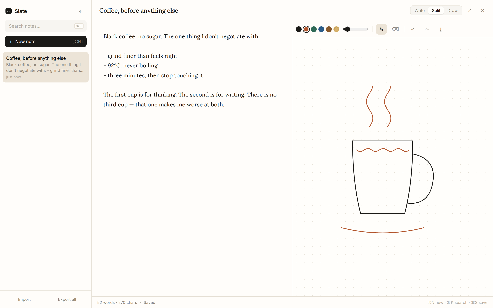
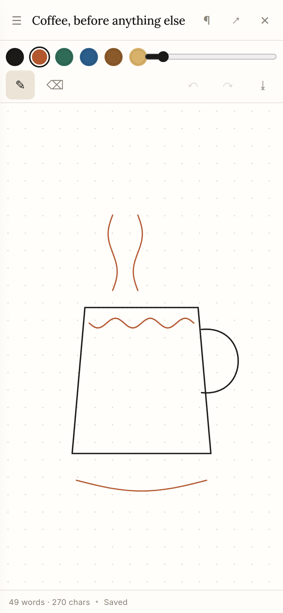

# Slate

**Notes and sketches, in one tab. No account, no server, no build step.**

A clean, quiet place to write. If a note needs a diagram, the canvas is right there
beside it — pen, pressure, eraser, undo. Everything lives in your browser's local
storage, so it works offline and nothing leaves the device.



## What it does

- **Notes** — sidebar list, search, autosave, word count. Written in a quiet
  contenteditable page set in Lora; the text is still stored as the same plain,
  markdown-ish string.
- **Formatting that gets out of the way** — headings, bullet and numbered lists, code
  blocks with a copy button, and links that light up on their own. Type the markdown
  (`# `, `- `, `1. `, `` ``` ``) or use the little row above the page; the syntax
  never shows.
- **Sketch pane** — draw beside the note, or switch to a full canvas when you need room.
  Six inks, adjustable brush, pressure-sensitive with a pen or tablet, eraser, undo/redo.
- **Paste a screenshot, anywhere** — `⌘V` with an image on the clipboard. In the note it
  drops **right where the caret is**, in the flow of the text: click it to zoom, Backspace
  next to it to remove it. In the canvas it lands under your ink, sized to fit, ready to trace
  over — hide or remove it from the chip in the corner. Images are re-encoded smaller, they
  persist with the note, and they never leave the device.
- **Three layouts** — Write (text only), Split (both), Draw (canvas only). Remembered.
- **Share by link** — the whole note, drawing included, is deflate-compressed into the
  URL hash. Send it; it opens as a note on the other side. No server involved. Big images
  won't fit in a URL — use Export all for those.
- **Backup** — export everything as JSON, import it back. Also export a drawing as PNG.
- **Light and dark** — follows your system, or pick one.
- **Works offline** — the service worker keeps the app cached, so it opens with no network
  at all. The notes never needed one.
- **Installs like an app** — on a phone (or Chrome on the desktop) it gets a home-screen
  icon, opens full screen with no browser chrome, and offers *New note / Draw / Search* as
  long-press shortcuts.

## Formatting

Type it, the way you would in any markdown file — the marker disappears and the line
becomes that thing. The row above the page does the same job for a line you already
wrote:

| Type this | You get |
|---|---|
| `# ` | Heading |
| `## ` | Subheading |
| `### ` | Smaller heading again |
| `- ` or `* ` | Bulleted list |
| `1. ` | Numbered list |
| `` ``` `` | Code block (ends with `` ``` `` on its own line) |
| `https://…` or `www.…` | A link — highlighted when you leave the line, click to open |

- **Enter** in a list or a code block continues it; **Enter** on an empty list item drops
  back to a paragraph.
- **Backspace** at the start of a formatted line turns it back into a paragraph first, so
  you never eat the line above by accident.
- **Hover a code block** for a Copy button — it copies the block without the fence.
- **Paste** a markdown snippet and it lands formatted: headings, lists and fences are read
  as you paste.

## Shortcuts

| Key | Action |
|---|---|
| `⌘N` / `Ctrl+N` | New note |
| `⌘K` / `Ctrl+K` | Search |
| `⌘S` / `Ctrl+S` | Save now (it autosaves anyway) |
| `⌘Z` / `Shift+⌘Z` | Undo / redo a stroke (when not typing) |
| `Esc` | Close the notes drawer on mobile |

## Run it

There is nothing to install:

```bash
open index.html          # macOS
xdg-open index.html      # Linux
```

Or serve it: `python3 -m http.server 8089` → http://127.0.0.1:8089

### Hosting it

It's a folder of static files, so anywhere that serves HTML works — no build, no runtime:

- **Locally** — keep the file on your machine and open it. Works offline forever.
- **Vercel / Netlify / Cloudflare Pages** — drag the folder in, or connect the repo.
  Framework preset: *Other*, build command: none, output directory: `.`
- **Your own VPS** — drop it in `/var/www/slate/` and point nginx at it:

  ```nginx
  server {
    listen 80;
    server_name notes.example.com;
    root /var/www/slate;
    index index.html;
  }
  ```

Because notes live in `localStorage`, the *same* note list is only visible on the
browser and origin where it was written. Moving from `file://` to `https://…` is a new
storage area — export your notes as JSON first, then import them on the new origin.

## On your phone



The same page is one screen on a phone: the notes move into a drawer, the top bar carries a
single draw/write switch, and the drawing tools fold into two rows instead of running off the
edge. *Split* is not offered below 940 px — it needs the width.

Installing needs the page served over `https://` (or `localhost`); browsers refuse to install
from a `file://` page, and the offline cache needs a secure origin too.

- **Android / Chrome** — open the site, ⋮ menu → *Install app*, or tap the **Install Slate**
  card at the bottom of the notes drawer.
- **iPhone / Safari** — open the site, tap Share, then *Add to Home Screen*. iOS never shows
  an install prompt, so the drawer shows that instruction instead.

Installed, it opens full screen, works with no signal, and its launcher shortcuts open a
blank note, the canvas or search directly.

Two things worth knowing: the on-screen keyboard no longer covers the line you are typing
(the app follows the visible area rather than the layout viewport), and notes stay
per-device — the phone starts with its own list, so export from the laptop and import on the
phone to move work across.

## How it's built

`index.html` holds the whole app — HTML, CSS, vanilla JavaScript. No framework, no bundler,
no dependencies, no fonts to install (Google Fonts, with system fallbacks). Around it sit the
pieces a browser needs to install it: `manifest.webmanifest`, `sw.js` (the offline cache) and
`icons/`. Total: ~75 KB plus icons.

**Strokes are stored as vectors, not pixels** — arrays of normalised points with pressure.
That means a drawing stays sharp at any window size and re-renders perfectly after a
resize, instead of blurring like a saved bitmap.

**Pasted images are re-encoded before they're stored** — scaled down to at most 1600 px on
the long edge and compressed to WebP in the browser, so a 4 MB screenshot lands at a
fraction of that. They live in the note's own record as data URLs, which is why they survive
a reload and travel with export/import. Canvas images keep normalised placement, so they
stay put when the pane resizes.

**The note pane is a light rich editor, not a `<textarea>`.** That is the price of an image
sitting in the text instead of in a corner: a plain textarea can only hold characters. The
document is one block per line (with a `data-t` telling it heading, list, code or paragraph),
and every change is serialized straight back to the same markdown-ish body — `# ` for a
heading, `- ` for a bullet, fences around code, `` at its exact
position. Nothing in the format moved, so search, share links, export and older notes all
still read it, and the file you export is still readable as plain text.

**Sharing uses the browser's own compression.** `CompressionStream('deflate-raw')` packs
the note into base64url; the receiver's browser decompresses it. No library, no server,
no database — a link *is* the note.

## Privacy

Notes never leave the browser. No analytics, no requests except the font files — a pasted
screenshot is read and compressed in the page, never uploaded. Export regularly: local
storage is cleared when you clear site data, and it is per-browser and per-device. Images
share the same ~5 MB storage budget as your text, so a lot of screenshots will fill it
faster than words do.

---

**Created with love by Lukas.**
