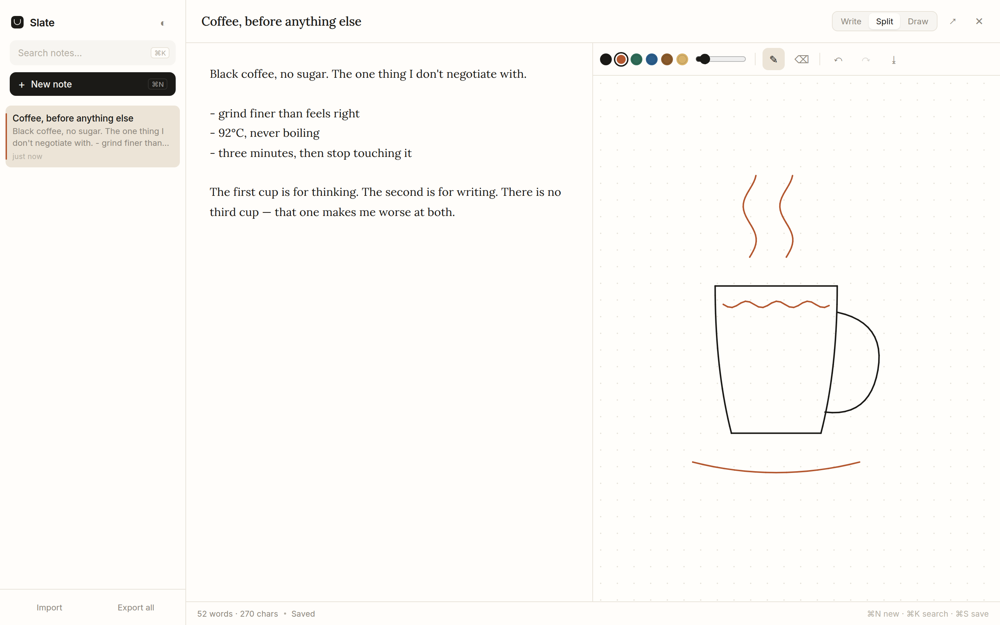

# Slate

**Notes and sketches, in one tab. No account, no server, no build step.**

A clean, quiet place to write. If a note needs a diagram, the canvas is right there
beside it — pen, pressure, eraser, undo. Everything lives in your browser's local
storage, so it works offline and nothing leaves the device.



## What it does

- **Notes** — sidebar list, search, autosave, word count. Markdown-ish plain text,
  set in Lora.
- **Sketch pane** — draw beside the note, or switch to a full canvas when you need room.
  Six inks, adjustable brush, pressure-sensitive with a pen or tablet, eraser, undo/redo.
- **Three layouts** — Write (text only), Split (both), Draw (canvas only). Remembered.
- **Share by link** — the whole note, drawing included, is deflate-compressed into the
  URL hash. Send it; it opens as a note on the other side. No server involved.
- **Backup** — export everything as JSON, import it back. Also export a drawing as PNG.
- **Light and dark** — follows your system, or pick one.
- **Works offline** — it's one file. Save it, open it, done.

## Shortcuts

| Key | Action |
|---|---|
| `⌘N` / `Ctrl+N` | New note |
| `⌘K` / `Ctrl+K` | Search |
| `⌘S` / `Ctrl+S` | Save now (it autosaves anyway) |
| `⌘Z` / `Shift+⌘Z` | Undo / redo a stroke (when not typing) |
| `Esc` | Close the notes drawer on mobile |

## Run it

There is nothing to install:

```bash
open index.html          # macOS
xdg-open index.html      # Linux
```

Or serve it: `python3 -m http.server 8089` → http://127.0.0.1:8089

### Hosting it

It's a static file, so anywhere that serves HTML works — no build, no runtime:

- **Locally** — keep the file on your machine and open it. Works offline forever.
- **Vercel / Netlify / Cloudflare Pages** — drag the folder in, or connect the repo.
  Framework preset: *Other*, build command: none, output directory: `.`
- **Your own VPS** — drop it in `/var/www/slate/` and point nginx at it:

  ```nginx
  server {
    listen 80;
    server_name notes.example.com;
    root /var/www/slate;
    index index.html;
  }
  ```

Because notes live in `localStorage`, the *same* note list is only visible on the
browser and origin where it was written. Moving from `file://` to `https://…` is a new
storage area — export your notes as JSON first, then import them on the new origin.

## How it's built

One `index.html` — HTML, CSS, and vanilla JavaScript. No framework, no bundler, no
dependencies, no fonts to install (Google Fonts, with system fallbacks). Total: ~35 KB.

**Strokes are stored as vectors, not pixels** — arrays of normalised points with pressure.
That means a drawing stays sharp at any window size and re-renders perfectly after a
resize, instead of blurring like a saved bitmap.

**Sharing uses the browser's own compression.** `CompressionStream('deflate-raw')` packs
the note into base64url; the receiver's browser decompresses it. No library, no server,
no database — a link *is* the note.

## Privacy

Notes never leave the browser. No analytics, no requests except the font files. Export
regularly: local storage is cleared when you clear site data, and it is per-browser and
per-device.

---

**Created with love by Lukas.**
